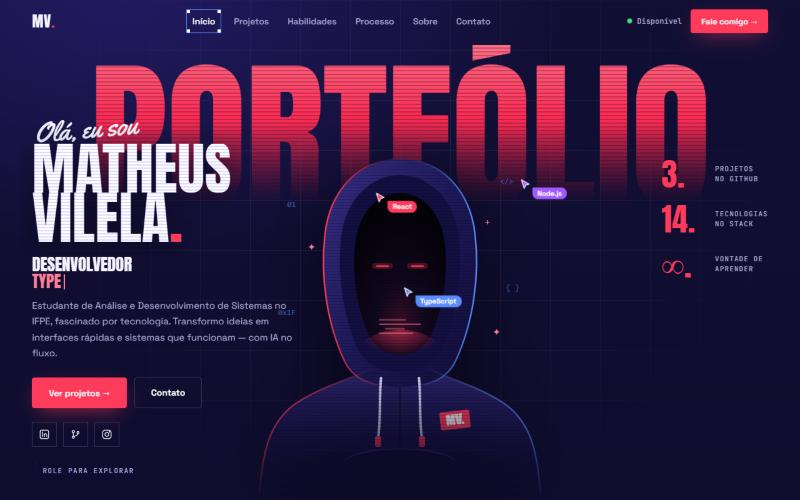

<div align="center">

```
 ███╗   ███╗██╗   ██╗    ┌─────────────────────────────────────────┐
 ████╗ ████║██║   ██║    │  $ whoami                               │
 ██╔████╔██║██║   ██║    │  matheus_vilela — dev front & back-end  │
 ██║╚██╔╝██║╚██╗ ██╔╝    │  $ status                               │
 ██║ ╚═╝ ██║ ╚████╔╝     │  ● disponível para novos projetos       │
 ╚═╝     ╚═╝  ╚═══╝  ▪   └─────────────────────────────────────────┘
```

# Portfólio · Matheus Vilela

**Não é só código. É resolver problemas.**

Estudante de **Análise e Desenvolvimento de Sistemas** no **IFPE**,
técnico em informática e fascinado por tecnologia.


[](LICENSE)



</div>

---

## ▶ Boot sequence

Ao abrir o site, a página **se monta na sua frente**:

```
[000%]  desenhando wireframe ......... ▢ navbar  ▢ display  ▢ h1  ▢ image
[045%]  aplicando estilos ............ ■ cores   ■ fontes   ■ grid
[100%]  pronto ....................... ▲ a cortina sobe, o hero entra
```

Depois disso, cada elemento continua aparecendo do mesmo jeito: primeiro um **contorno de seleção estilo Figma** (com alças e etiqueta azul), depois o conteúdo.

## ✦ O que tem aqui dentro

| | Efeito | Onde mora |
|---|---|---|
| 🧱 | **Intro em wireframe** com contador 000% → 100% | `components/IntroLoader.tsx` |
| 🟦 | **Revelação em "frame"**: contorno desenhado → conteúdo revelado | `components/Reveal.tsx` |
| 🖱️ | **Rastro de cursores**: setinhas e brilhos que seguem o mouse | `components/CursorTrail.tsx` |
| 👥 | **Cursores "colaborativos"** (React, TypeScript, Node.js) passeando pelo hero | `sections/HeroSection.tsx` |
| ↔️ | **Comparador código × resultado** arrastável (com teclado também) | `components/CompareSlider.tsx` |
| 📜 | **Faixa infinita** com o stack | `components/Marquee.tsx` |
| 🎯 | **Menu que sabe onde você está** (seção ativa ganha a caixa de seleção) | `hooks/useActiveSection.ts` |
| 🌿 | **Louros desenhados por matemática** (folhas ao longo de uma curva de Bézier) | `sections/TecnologiasSection.tsx` |

Tudo isso com **CSS + hooks próprios**. Nenhuma biblioteca de animação foi instalada.

> ♿ Quem ativa *reduzir movimento* no sistema vê o site completo, sem animação nenhuma.

## 🗺️ Mapa do site

```
00  Início       PORTFÓLIO gigante, nome, digitação, números
01  Projetos     "Projetos que falam por si." · cards com print real + filtro por status
──  Marquee      Java ✦ Python ✦ TypeScript ✦ React ✦ ... ✦ ChatGPT ✦ Claude
02  Habilidades  "O código. A prática." · 14 tecnologias com barra de nível + filtro
03  Processo     "Do código. À tela." · arraste a divisória
04  Sobre        "Não é só código. É resolver problemas." · trajetória + citação
05  Contato      "Vamos conversar?"
```

## 🧠 Stack

```ts
const stack = {
  linguagens:  ["Java", "Python", "JavaScript", "TypeScript"],
  frontend:    ["HTML", "CSS", "React"],
  backend:     ["Node.js", "PHP", "Next.js"],
  ferramentas: ["Git", "MySQL"],
  ia:          ["ChatGPT", "Claude"],   // parceiros de pesquisa, revisão e prototipação
};
```

## 🚀 Rodando na sua máquina

```bash
git clone https://github.com/Matheusvilela1/portfolio.git
cd portfolio
npm install
npm start          # http://localhost:3000
```

```bash
npm run build      # versão otimizada na pasta build/
```

## 🎛️ Personalize em 1 arquivo

Quase tudo que aparece na tela vem de **`src/data/index.ts`**:

| Quer mudar… | Edite |
|---|---|
| Projetos (título, descrição, links, print) | `PROJECTS` — o print vai em `public/projects/` e no campo `image` |
| Tecnologias e níveis | `TECHS` |
| Palavras que o hero digita | `TYPE_WORDS` |
| Trajetória da seção Sobre | `TIMELINE` |
| Foto do hero | `HERO_PHOTO` → hoje aponta para `public/foto.png` (PNG 600×800 sem fundo) |

As cores ficam como variáveis no topo de **`src/index.css`**:

```css
--bg:   #0a0920;   /* índigo quase preto */
--red:  #ff3b5c;   /* o vermelho de tudo */
--sel:  #5b8cff;   /* o azul das caixas de seleção */
```

## 🗂️ Estrutura

```
src/
├── data/        ← conteúdo do site (comece por aqui)
├── types/       ← TechItem, ProjectItem, TimelineItem...
├── hooks/       ← useVisible · useActiveSection · useTypingEffect · useScrolled
├── components/  ← Reveal · IntroLoader · CursorTrail · CompareSlider · Marquee · cards
├── sections/    ← Hero · Projetos · Tecnologias · Processo · Sobre · Contato
├── index.css    ← tokens, animações e layout responsivo
└── App.tsx      ← monta tudo em ordem
public/
├── foto.png     ← foto do hero, recortada sem fundo
├── foto.svg     ← avatar alternativo: hacker de capuz desenhado em SVG
└── projects/    ← prints dos projetos
```

## 📄 Licença

Código aberto sob a licença **MIT**: pode usar, copiar e adaptar à vontade, desde que mantenha o aviso de copyright. O texto completo está em [`LICENSE`](LICENSE).

## 📡 Contato

<div align="center">

[](https://www.linkedin.com/in/macv55/)
[](https://github.com/Matheusvilela1)
[](https://www.instagram.com/vilela_05/)
[](mailto:1macv9@gmail.com)

```
$ exit
> obrigado por ler até aqui. agora vai lá ver o site rodando ✦
```

</div>
